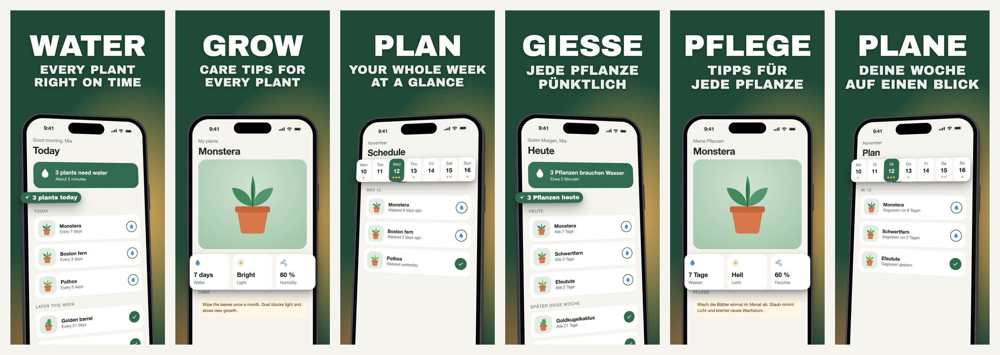
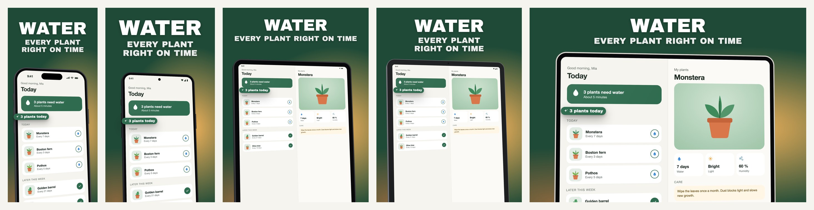

# store-screenshots

A Claude Code skill that makes App Store and Google Play screenshot sets from start to finish:
it finds the benefits in your codebase, captures real screens from iOS simulators and Android
emulators in every language, puts them in device frames with headlines and callouts, and
renders every locale and device size in one go.



One project renders iPhone, Android phone, iPad, Android tablet and iPhone Duo:



The tiles above come from `examples/demo`, a fictional plant care app. Clone the repo and
render them yourself in under a minute.

## Why a canvas and not an image model

Image models redraw your UI and your text, so prices change, words come out misspelled,
and every language drifts a little. Here the UI is the real capture and every headline is
text in a JSON file. The render is deterministic: a new language is one JSON file plus
captures, and fixing one tile never touches the others.

## What it does

1. **Benefits.** Reads your navigation, onboarding and paywall copy and proposes one slide per
   benefit: a short verb (`PLAN`, `SAVE`) and a subline.
2. **Capture.** `capture.py` creates dedicated simulators, boots Android emulators, switches
   the language, sets a clean status bar and walks through your screens with deep links, taps
   and text input. It retakes a screen while a skeleton or spinner is still showing.
3. **Compose.** `set.json` places the device, tilts it, and lifts elements out of the
   screen: crops of the real UI, or vector callouts with translated text.
4. **Render.** Playwright renders every locale x device x slide at store resolution, with
   contact sheets for review.
5. **Scale.** `add_locale.py` adds a language: placeholders, re-measured element positions per
   language, and a check that flags missing captures and untranslated text.

## Install

As a plugin:

```
/plugin marketplace add meth0xy/store-screenshots
/plugin install store-screenshots@store-screenshots
```

Or copy the skill folder:

```bash
git clone https://github.com/meth0xy/store-screenshots
cp -R store-screenshots/skills/store-screenshots ~/.claude/skills/
```

Then set up Python once, in the skill folder:

```bash
python3 -m venv .venv
.venv/bin/pip install -r requirements.txt
.venv/bin/playwright install chromium
```

Ask Claude for screenshots ("make App Store screenshots for this app") or run
`/store-screenshots`.

## Try the demo

```bash
cd store-screenshots
skills/store-screenshots/.venv/bin/python skills/store-screenshots/render.py examples/demo
open examples/demo/out/_sheets
```

`examples/demo/app/make_captures.py` stands in for the simulator: it renders the demo app's
HTML screens at simulator resolutions. With a real app, `capture.py` fills the same folders.

## Requirements

| For | Needs |
|---|---|
| Rendering | Python 3.10+, Playwright Chromium (installed above) |
| iOS capture | macOS with Xcode. Taps and text input also need [idb](https://fbidb.io); deep links do not |
| Android capture | Android SDK with `adb` and `emulator`, an AVD per device |

Cross-platform apps (React Native, Flutter) can capture on iOS only: the Android tiles reuse
the iPhone and iPad captures in Android frames.

## Capturing your app

`capture.json` in your project lists the app, the devices and the screens:

```json
{
  "app": {
    "ios": {"bundleId": "com.example.myapp", "app": "build/MyApp.app"},
    "android": {"package": "com.example.myapp", "apk": "build/app-release.apk"}
  },
  "devices": {
    "phone":   {"platform": "ios", "name": "Capture iPhone", "type": "iPhone 17 Pro", "dir": "sim"},
    "tablet":  {"platform": "ios", "name": "Capture iPad", "type": "iPad Pro 13-inch (M5)", "dir": "sim-tablet"},
    "android": {"platform": "android", "avd": "Pixel_9_API_36", "dir": "sim-android"}
  },
  "screens": [
    {"id": "01-home", "steps": [{"open": "myapp://home", "wait": 4}]},
    {"id": "02-search", "steps": [{"tap": {"label": "Search"}}, {"type": "pasta"}, {"key": "enter"}]}
  ]
}
```

```bash
python capture.py <project> doctor
python capture.py <project> setup
python capture.py <project> run --locale de-DE
```

The full reference (steps, ready checks, locale modes, iPhone Duo, per-device overrides) is in
[`SKILL.md`](skills/store-screenshots/SKILL.md).

## Device frames

The bundled frames are generic drawings made by `make_frame.py`, so the repo has no vendor
artwork and works right after cloning. `make_frame.py` draws a frame for any capture size.
For official bezels, download Apple's Product Bezels or Google's Device Art and run
`prepare_device.py` on them. Their licences allow use in your own marketing but not
redistribution, so keep them out of public forks.

## Credits

Built for and used in production by [Flyva](https://flyva.app). Archivo Black is by
Omnibus-Type (SIL OFL 1.1). See [THIRD_PARTY.md](THIRD_PARTY.md).

## License

MIT
